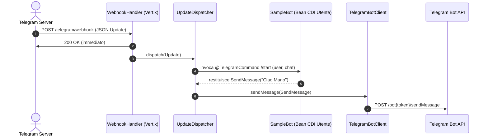

# Struttura del Progetto: Quarkus Telegram Bot SDK

La struttura del progetto segue il paradigma **Build-Time First** caratteristico delle estensioni **Quarkiverse / Quarkus**.

L'idea fondamentale di Quarkus è spostare quante più operazioni possibili (scansione delle annotazioni, validazioni, configurazione per GraalVM Native) dalla fase di avvio (*runtime*) alla fase di compilazione (*build-time*). Per farlo, il codice è suddiviso in moduli Maven distinti con ruoli e cicli di vita separati.

---

## 1. Panoramica dei Moduli Maven

```text
quarkus-telegram-bot/
├── pom.xml                   # Parent POM (gestione dipendenze, Quarkus BOM, Java 21)
│
├── deployment/               # Codice eseguito SOLO durante "mvn compile / package"
│   └── src/main/java/.../deployment/
│       ├── TelegramBotProcessor.java  # Motore Jandex: scansiona annotazioni, registra bean e reflection
│       └── HandlerBuildItem.java      # Metadati intermedi scambiati tra i @BuildStep
│
├── runtime/                  # Codice incluso nel binario/JAR finale dell'applicazione
│   └── src/main/java/.../runtime/
│       ├── api/              # Annotazioni pubbliche (@TelegramCommand, @OnCallbackQuery, ecc.)
│       ├── model/            # DTO e record immutabili Java 21 (Message, User, SendMessage, ecc.)
│       ├── client/           # Client REST reattivo (TelegramBotApi) e facciata (TelegramBotClient)
│       ├── config/           # Mapping configurazioni (TelegramBotConfig, TelegramBotBuildTimeConfig)
│       ├── dispatcher/       # Motore di routing reattivo (UpdateDispatcher) e risoluzione argomenti
│       ├── transport/        # Gestione canali HTTP Webhook (Vert.x) e Long Polling (Mutiny)
│       ├── session/          # Gestione sessioni e FSM (ConversationContext, SessionStore)
│       └── TelegramBotRecorder.java   # Bytecode recorder: ponte di inizializzazione tra build e runtime
│
├── integration-tests/        # Applicazione di test completa che simula un bot reale
│   ├── src/main/java/        # Bot di test (@ApplicationScoped SampleBot con comandi e callback)
│   └── src/test/java/        # Test JVM e Native con WireMock (TelegramMockServer)
│
└── docs/                     # Documentazione ufficiale Antora/AsciiDoctor per Quarkiverse
```

---

## 2. Dettaglio dei Singoli Componenti

### Modulo `deployment` (Solo a Compilazione)
Questo modulo **non viene incluso** nell'artefatto finale dell'applicazione:
* **`TelegramBotProcessor.java`:**
  * Sfrutta l'indice **Jandex** per individuare automaticamente a compile-time tutte le classi annotate con `@TelegramCommand`, `@OnCallbackQuery` e `@OnMessage`.
  * Registra i bean gestiti come `UnremovableBeanBuildItem`, prevenendo la rimozione automatica da parte del container CDI ArC.
  * Registra i modelli, i payload e i metodi per la reflection su **GraalVM Native** (`ReflectiveClassBuildItem` e `ReflectiveMethodBuildItem`).
  * Monta a compile-time la rotta HTTP su Vert.x per l'endpoint Webhook.

### Modulo `runtime` (Nel Classpath Applicativo)
Contiene l'infrastruttura eseguita quando il bot è in esecuzione:
* **`api/`:** Annotazioni esposte agli sviluppatori (`@TelegramCommand`, `@OnCallbackQuery`, `@OnMessage`, `@OnState`, `@CallbackParam`, `@SessionPayload`).
* **`model/`:** Modelli di dominio definiti come **Java 21 `record`** con Jackson, immutabili e thread-safe.
* **`client/`:**
  * `TelegramBotApi.java`: Interfaccia JAX-RS / Quarkus REST Client reattivo basato su Mutiny `Uni`.
  * `TelegramBotClient.java`: Facciata applicativa `@ApplicationScoped` per interagire con Telegram con metodi idiomatici.
* **`dispatcher/`:**
  * `UpdateDispatcher.java`: Riceve l'oggetto `Update`, determina quale metodo deve gestirlo, inietta automaticamente i parametri richiesti (`User`, `Chat`, `Message`, `ConversationContext`) e gestisce l'invio della risposta.
* **`transport/`:**
  * `WebhookHandler.java`: Handler HTTP Vert.x montato sul path configurato (`/telegram/webhook`), valida il token segreto `X-Telegram-Bot-Api-Secret-Token` e risponde immediatamente `200 OK` delegando l'elaborazione al dispatcher in modo asincrono.
  * `PollingRunner.java`: Loop reattivo non-bloccante che interroga Telegram con `getUpdates` (ideale per `quarkus:dev` in locale senza tunnel ngrok o per bot hosted senza IP pubblico).
* **`session/`:**
  * Supporto per macchine a stati finiti (FSM) e conversazioni multi-step indicizzate per coppia `(chatId, userId)`. Implementazione di default in-memory (`InMemorySessionStore.java`), estendibile a Redis.

### Modulo `integration-tests`
È un progetto Quarkus a tutti gli effetti che importa l'estensione:
* Contiene `SampleBot.java`, che dimostra l'uso dell'SDK con annotazioni dichiarative.
* Include `TelegramMockServer.java` basato su **WireMock** per emulare le API Telegram, permettendo di eseguire test completi e affidabili sia su JVM che su binario nativo senza dipendere dalla rete o da bot reali.

---

## 3. Flusso di Elaborazione di un Update


